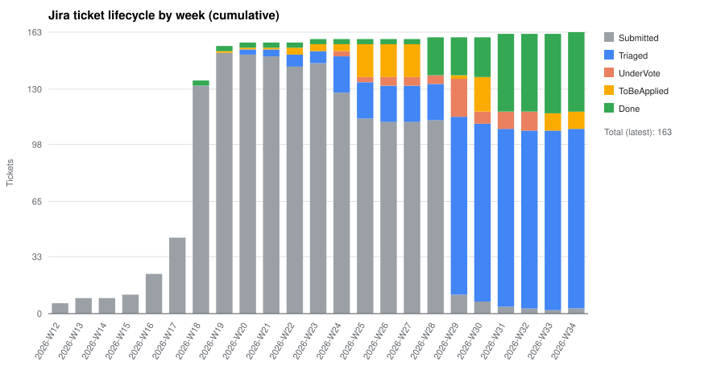

## Current Status

| Resolution \ Status | Applied | Resolved - change required | Resolved - No Change | Submitted | Triaged | Waiting for Input | Total |
|---|:---:|:---:|:---:|:---:|:---:|:---:|---:|
| Not Persuasive | 0 | 0 | 2 | 0 | 0 | 0 | [2](https://jira.hl7.org/issues/?jql=project%20%3D%20FHIR%20AND%20Specification%20%3D%20%22EU%20Health%20Data%20API%20(R4)%20(FHIR)%20%5BFHIR-eu-health-data-api%5D%22%20AND%20resolution%20%3D%20%22Not%20Persuasive%22) |
| Not Persuasive with Modification | 0 | 4 | 0 | 0 | 0 | 0 | [4](https://jira.hl7.org/issues/?jql=project%20%3D%20FHIR%20AND%20Specification%20%3D%20%22EU%20Health%20Data%20API%20(R4)%20(FHIR)%20%5BFHIR-eu-health-data-api%5D%22%20AND%20resolution%20%3D%20%22Not%20Persuasive%20with%20Modification%22) |
| Persuasive | 31 | 4 | 0 | 0 | 0 | 0 | [35](https://jira.hl7.org/issues/?jql=project%20%3D%20FHIR%20AND%20Specification%20%3D%20%22EU%20Health%20Data%20API%20(R4)%20(FHIR)%20%5BFHIR-eu-health-data-api%5D%22%20AND%20resolution%20%3D%20%22Persuasive%22) |
| Persuasive with Modification | 10 | 2 | 0 | 0 | 0 | 0 | [12](https://jira.hl7.org/issues/?jql=project%20%3D%20FHIR%20AND%20Specification%20%3D%20%22EU%20Health%20Data%20API%20(R4)%20(FHIR)%20%5BFHIR-eu-health-data-api%5D%22%20AND%20resolution%20%3D%20%22Persuasive%20with%20Modification%22) |
| Retracted | 0 | 0 | 3 | 0 | 0 | 0 | [3](https://jira.hl7.org/issues/?jql=project%20%3D%20FHIR%20AND%20Specification%20%3D%20%22EU%20Health%20Data%20API%20(R4)%20(FHIR)%20%5BFHIR-eu-health-data-api%5D%22%20AND%20resolution%20%3D%20%22Retracted%22) |
| Unresolved | 0 | 0 | 0 | 3 | 86 | 18 | [107](https://jira.hl7.org/issues/?jql=project%20%3D%20FHIR%20AND%20Specification%20%3D%20%22EU%20Health%20Data%20API%20(R4)%20(FHIR)%20%5BFHIR-eu-health-data-api%5D%22%20AND%20resolution%20%3D%20%22Unresolved%22) |
| **Total** | [41](https://jira.hl7.org/issues/?jql=project%20%3D%20FHIR%20AND%20Specification%20%3D%20%22EU%20Health%20Data%20API%20(R4)%20(FHIR)%20%5BFHIR-eu-health-data-api%5D%22%20AND%20status%20%3D%20%22Applied%22) | [10](https://jira.hl7.org/issues/?jql=project%20%3D%20FHIR%20AND%20Specification%20%3D%20%22EU%20Health%20Data%20API%20(R4)%20(FHIR)%20%5BFHIR-eu-health-data-api%5D%22%20AND%20status%20%3D%20%22Resolved%20-%20change%20required%22) | [5](https://jira.hl7.org/issues/?jql=project%20%3D%20FHIR%20AND%20Specification%20%3D%20%22EU%20Health%20Data%20API%20(R4)%20(FHIR)%20%5BFHIR-eu-health-data-api%5D%22%20AND%20status%20%3D%20%22Resolved%20-%20No%20Change%22) | [3](https://jira.hl7.org/issues/?jql=project%20%3D%20FHIR%20AND%20Specification%20%3D%20%22EU%20Health%20Data%20API%20(R4)%20(FHIR)%20%5BFHIR-eu-health-data-api%5D%22%20AND%20status%20%3D%20%22Submitted%22) | [86](https://jira.hl7.org/issues/?jql=project%20%3D%20FHIR%20AND%20Specification%20%3D%20%22EU%20Health%20Data%20API%20(R4)%20(FHIR)%20%5BFHIR-eu-health-data-api%5D%22%20AND%20status%20%3D%20%22Triaged%22) | [18](https://jira.hl7.org/issues/?jql=project%20%3D%20FHIR%20AND%20Specification%20%3D%20%22EU%20Health%20Data%20API%20(R4)%20(FHIR)%20%5BFHIR-eu-health-data-api%5D%22%20AND%20status%20%3D%20%22Waiting%20for%20Input%22) | [163](https://jira.hl7.org/issues/?jql=project%20%3D%20FHIR%20AND%20Specification%20%3D%20%22EU%20Health%20Data%20API%20(R4)%20(FHIR)%20%5BFHIR-eu-health-data-api%5D%22) |

Each bar is a cumulative snapshot at the end of that ISO week; the stack height equals the total number of tickets submitted so far.

Generated: 2026-08-19
Tickets included: 163

## Weekly counts

| Week | Week start | Total | Submitted | Triaged | UnderVote | ToBeApplied | Done |
|---|---|---:|---:|---:|---:|---:|---:|
| 2026-W12 | 2026-03-16 | 6 | 6 | 0 | 0 | 0 | 0 |
| 2026-W13 | 2026-03-23 | 9 | 9 | 0 | 0 | 0 | 0 |
| 2026-W14 | 2026-03-30 | 9 | 9 | 0 | 0 | 0 | 0 |
| 2026-W15 | 2026-04-06 | 11 | 11 | 0 | 0 | 0 | 0 |
| 2026-W16 | 2026-04-13 | 23 | 23 | 0 | 0 | 0 | 0 |
| 2026-W17 | 2026-04-20 | 44 | 44 | 0 | 0 | 0 | 0 |
| 2026-W18 | 2026-04-27 | 135 | 132 | 0 | 0 | 0 | 3 |
| 2026-W19 | 2026-05-04 | 155 | 151 | 0 | 0 | 1 | 3 |
| 2026-W20 | 2026-05-11 | 157 | 150 | 3 | 0 | 1 | 3 |
| 2026-W21 | 2026-05-18 | 157 | 149 | 4 | 0 | 1 | 3 |
| 2026-W22 | 2026-05-25 | 157 | 143 | 7 | 0 | 4 | 3 |
| 2026-W23 | 2026-06-01 | 159 | 145 | 7 | 0 | 4 | 3 |
| 2026-W24 | 2026-06-08 | 159 | 128 | 21 | 3 | 4 | 3 |
| 2026-W25 | 2026-06-15 | 159 | 113 | 21 | 3 | 19 | 3 |
| 2026-W26 | 2026-06-22 | 159 | 111 | 21 | 5 | 19 | 3 |
| 2026-W27 | 2026-06-29 | 159 | 111 | 21 | 5 | 19 | 3 |
| 2026-W28 | 2026-07-06 | 160 | 112 | 21 | 5 | 0 | 22 |
| 2026-W29 | 2026-07-13 | 160 | 11 | 103 | 22 | 2 | 22 |
| 2026-W30 | 2026-07-20 | 160 | 7 | 103 | 7 | 20 | 23 |
| 2026-W31 | 2026-07-27 | 162 | 4 | 103 | 10 | 0 | 45 |
| 2026-W32 | 2026-08-03 | 162 | 3 | 103 | 11 | 0 | 45 |
| 2026-W33 | 2026-08-10 | 162 | 2 | 104 | 0 | 10 | 46 |
| 2026-W34 | 2026-08-17 | 163 | 3 | 104 | 0 | 10 | 46 |

## Methodology

- Sources: `jira/open`, `jira/closed`, and `jira/active*` ticket markdown files (deduplicated by `Key`).
- Stage mapping from the ticket `Status` field:
  - Submitted: Submitted
  - Triaged: Triaged, Waiting for Input, Deferred
  - ToBeApplied: Resolved - change required
  - Done: Resolved - No Change, Duplicate, Applied
- Transition dates are approximated from the exported `Created`, `Resolved`, and `Updated` fields because per-status transition history is not present in the local ticket markdown.
- `ToBeApplied` covers tickets with an agreed disposition that is not yet marked Done.
- Transition dates are forced to be non-decreasing per ticket.

